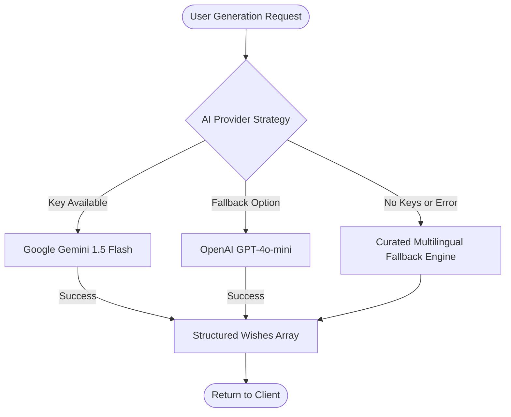

# 🪔 DiwaliWish – AI-Powered Diwali Greeting Platform

[](https://react.dev/)
[](https://vitejs.dev/)
[](https://tailwindcss.com/)
[](https://www.framer.com/motion/)
[](https://nodejs.org/)
[](#modular-ai-architecture)

> **"Illuminate Your World with Happiness!"**  
> *Celebrate the Festival of Lights with Love, Joy and Togetherness.*

**DiwaliWish** is a complete, production-ready, interactive Indian festive web application. It combines deep cultural traditions with modern AI engineering, allowing users worldwide to craft personalized multilingual greetings, design customized Diwali cards with live preview, immerse themselves in interactive diya and fireworks celebrations, and share festive warmth across WhatsApp and social channels.

---

## ✨ Key Features & Experience

### 1. 🏠 Animated Diwali Hero & Dynamic Countdown
- **Dynamic Diwali Countdown**: Automatically computes the exact days, hours, minutes, and seconds until the next Diwali according to the lunar Hindu calendar.
- **Glowing Diya Illustration**: Multi-layered SVG diya featuring animated flickering flames, inner heat cores, and radiant golden halos.
- **Full-Screen Canvas Fireworks & Particle Fields**: Background fireworks generator with particle trails, physics-based gravity decay, and twinkling golden motes.
- **Glassmorphic Diwali Aesthetics**: Crafted with a royal palette of deep purple (`#2D1B69`), midnight blue (`#0A0A2E`), bright saffron (`#FF6B00`), golden highlights (`#FFD700`), and subtle mandala patterns.

### 2. 🤖 AI Wishes Generator
- **Multi-Factor Personalization**:
  - **Recipients**: Friends, Family, Parents, Partner, Colleagues, Teachers.
  - **Languages**: English, Hindi (हिंदी), Hinglish, Sanskrit-inspired (सुभाषित-शैली).
  - **Tones**: Emotional, Funny, Romantic, Professional, Traditional.
  - **Lengths**: Short (1-2 sentences), Medium (3-4 sentences), Long (4-6 sentences with blessings).
- **Multiple Variations & Count Control**: Generate 1 to 5 variations simultaneously.
- **Instant Actions**:
  - 📋 **One-Click Copy**: Copies wish formatted with festive emojis.
  - 📱 **WhatsApp Direct Share**: Formats greeting ready to send to contacts or groups.
  - 💾 **Download as Image**: Uses `html-to-image` to turn any wish into a festive PNG.
  - 🔄 **Regenerate**: Generates fresh variations on demand.

### 3. 🎨 Interactive Greeting Card Creator
- **6 Premium Diwali Templates**: *Royal Gold*, *Saffron Bliss*, *Midnight Magic*, *Emerald Grace*, *Crimson Joy*, and *Ocean Calm*.
- **Live Interactive Preview**: Instant real-time updates as you edit.
- **Customizable Typography & Palettes**: Choose between serif display fonts (`Playfair Display`, `Georgia`), clean sans (`Inter`), and devanagari scripts with vibrant accent color themes.
- **Festive Accents**: Traditional rangoli and mandala corner designs, diya rows, and personalized signatures.
- **High-Resolution Export**: Download high-DPI cards ready for Instagram, WhatsApp, or printing.

### 4. 🖼️ Wishes Gallery
- **Extensive Curated Collections**: 50+ pre-crafted festive greetings across all categories and tones.
- **Search & Filtering**: Search by text keyword, filter by relationship, tone, or language.
- **Favorites System**: Save favorite wishes with persistent in-memory and local state.
- **Multi-Lingual Showcase**: Dedicated sections for pure Hindi, Hinglish, and English wishes.

### 5. 🪔 Interactive Festival Experience
- **Clickable Diyas**: Field of 10 interactive clay lamps that ignite with glowing flame effects and point counters upon clicking.
- **Interactive Fireworks**: Click anywhere on the night sky to launch custom multi-color burst fireworks.
- **Floating Sky Lanterns (Kandils)**: Release illuminated paper lanterns that float upward into the night sky.
- **Traditional Rangoli Showcase**: Detailed 6-color geometric SVG rangoli mandala with cultural symbolism notes.
- **Synthesized Festive Sound Effects**: Built-in **Web Audio API sound engine** that generates authentic firework bursts, sacred diya bell chimes, and meditative ambient drones—100% offline, zero external audio asset dependencies!

### 6. 📖 About Diwali & Cultural Heritage
- **Why Diwali is Celebrated**: Detailed narratives of Lord Rama's triumphant return to Ayodhya and Goddess Lakshmi's emergence from Samudra Manthan.
- **The Five Sacred Days**:
  1. *Dhanteras* (Wealth & Health)
  2. *Naraka Chaturdashi / Chhoti Diwali* (Triumph over inner negativity)
  3. *Lakshmi Puja / Main Diwali* (The night of lights)
  4. *Govardhan Puja / Annakut* (Harmony with nature)
  5. *Bhai Dooj* (Sacred bond of siblings)
- **Universal Philosophy**: Reflections on *Tamaso Ma Jyotirgamaya* ("From darkness, lead us to light").

---

## 🏛️ Architecture & Project Structure

```
DiwaliWishes/
├── frontend/                     # React 19 + Vite + Tailwind CSS Application
│   ├── public/
│   │   └── diya.svg              # Custom high-res SVG Diya favicon
│   ├── src/
│   │   ├── components/
│   │   │   ├── animations/       # Canvas fireworks & particle engines
│   │   │   │   ├── FireworksCanvas.jsx
│   │   │   │   └── ParticleField.jsx
│   │   │   └── layout/           # Responsive navigation & footer
│   │   │       ├── Navbar.jsx
│   │   │       └── Footer.jsx
│   │   ├── data/                 # Curated greeting collections & templates
│   │   │   ├── templates.js
│   │   │   └── wishes.js
│   │   ├── pages/                # All 6 core application views
│   │   │   ├── AboutDiwali.jsx
│   │   │   ├── AIGenerator.jsx
│   │   │   ├── CardCreator.jsx
│   │   │   ├── FestivalExperience.jsx
│   │   │   ├── Gallery.jsx
│   │   │   └── Home.jsx
│   │   ├── services/             # Axios API client & backend connection
│   │   │   └── api.js
│   │   ├── styles/               # Glassmorphism, animations, & Tailwind CSS
│   │   │   └── globals.css
│   │   ├── utils/                # Audio synthesizer, countdown & share helpers
│   │   │   ├── helpers.js
│   │   │   └── soundEngine.js
│   │   ├── App.jsx
│   │   └── main.jsx
│   ├── index.html
│   ├── tailwind.config.js
│   └── vite.config.js
│
├── backend/                      # Node.js + Express API Server
│   ├── src/
│   │   ├── middleware/           # Security & validation layers
│   │   │   ├── rateLimiter.js    # Express rate limiters
│   │   │   └── validator.js      # Request parameter validation
│   │   ├── routes/               # Modular Express routers
│   │   │   ├── ai.js             # /api/ai/generate-wishes
│   │   │   ├── cards.js          # /api/cards
│   │   │   └── wishes.js         # /api/wishes
│   │   ├── services/             # Strategy Pattern AI Engine
│   │   │   ├── aiProvider.js     # Orchestrator (Primary → Secondary → Fallback)
│   │   │   ├── fallbackService.js# Local curated wishes collection
│   │   │   ├── geminiService.js  # Google Gemini 1.5 Flash client
│   │   │   ├── openaiService.js  # OpenAI GPT-4o-mini client
│   │   │   └── promptBuilder.js  # Dynamic prompt construction
│   │   └── app.js                # Express app entry point & security headers
│   ├── .env                      # Local environment configuration
│   ├── .env.example              # Environment template
│   └── package.json
│
├── package.json                  # Root runner script configuration
└── README.md
```

---

## 🤖 Modular AI Architecture (Strategy Pattern)

DiwaliWish implements a robust **Strategy Pattern** for AI generation so the app never fails even if third-party APIs are down or unconfigured:



- **Primary Provider**: **Google Gemini 1.5 Flash** via `@google/generative-ai`
- **Secondary Provider**: **OpenAI GPT-4o-mini** via `openai`
- **Guaranteed Fallback**: Rich curated database of traditional, funny, emotional, and poetic wishes in English, Hindi, and Hinglish.

---

## 🚀 Getting Started

### Prerequisites
- **Node.js** (v18.0.0 or higher recommended)
- **npm** or **pnpm**

### Quick Start (Run Both Frontend & Backend)

1. **Clone or Navigate to the Project**:
   ```bash
   cd d:\DiwaliWishes
   ```

2. **Configure Backend Environment**:
   ```bash
   cd backend
   cp .env.example .env
   ```
   *(Optional)* Add your Gemini or OpenAI API keys inside `backend/.env`:
   ```env
   PORT=3001
   AI_PROVIDER=gemini
   GEMINI_API_KEY=your_actual_gemini_api_key_here
   OPENAI_API_KEY=your_actual_openai_api_key_here
   ```
   *Note: If no keys are provided, the system automatically runs the high-quality curated fallback engine!*

3. **Start the Backend Server**:
   ```bash
   cd d:\DiwaliWishes\backend
   npm start
   ```
   Server starts on `http://localhost:3001`.

4. **Start the Frontend Application**:
   Open a new terminal window:
   ```bash
   cd d:\DiwaliWishes\frontend
   npm run dev
   ```
   The application will be live at `http://localhost:5173`.

---

## 🛠️ API Reference

| Method | Endpoint | Description |
|---|---|---|
| `GET` | `/api/health` | Backend health, uptime, and status check |
| `GET` | `/api/ai/health` | Active AI provider credentials status |
| `POST` | `/api/ai/generate-wishes` | Generate personalized wishes (`recipient`, `language`, `tone`, `length`, `name`, `count`) |
| `GET` | `/api/wishes` | Get curated wishes collection |
| `GET` | `/api/wishes/categories` | Retrieve list of supported relationship categories |
| `POST` | `/api/wishes/favorite` | Toggle favorite state for a wish |
| `GET` | `/api/cards/templates` | Fetch available greeting card designs |
| `POST` | `/api/cards/save` | Save a personalized card and receive a shareable ID |
| `GET` | `/api/cards/:id` | Retrieve saved greeting card by ID |

---

## 🛡️ Security & Performance Best Practices

- **Strict CORS & Helmet Security**: `helmet` enabled for HTTP security headers and locked-down CORS origins.
- **Two-Tier Rate Limiting**:
  - Global API rate limiting: 50 requests / 15 minutes.
  - Dedicated AI route limiter: 20 calls / 15 minutes to prevent abuse.
- **Input Validation**: Strict schema sanitization with `express-validator` on all payload parameters.
- **Zero Exposed Keys**: Frontend never contains or receives private AI credentials; all calls are proxied via the backend.
- **Accessible & Responsive**: Full WCAG color contrast tuning, responsive breakpoints (`sm`, `md`, `lg`, `xl`), and `prefers-reduced-motion` compliance.

---

## 🪔 Happy Diwali! Shubh Deepavali!
May this festival of lights illuminate your life with infinite health, happiness, prosperity, and joy! 🪷✨
# DiwaliWishes

# DiwaliWishes

